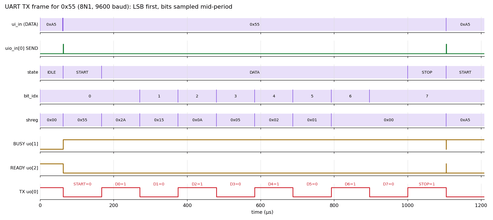
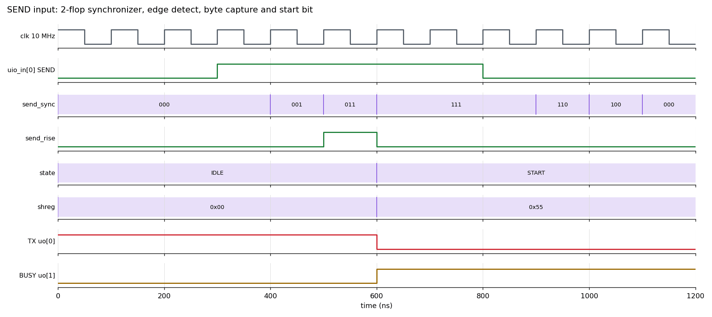
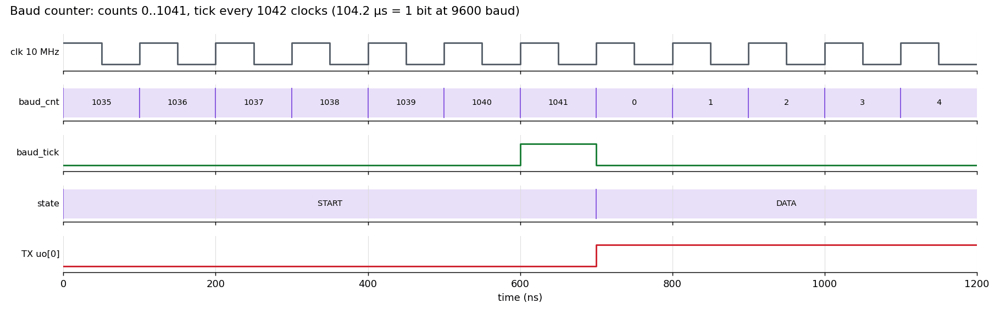
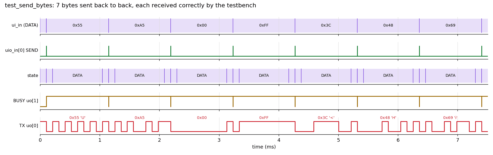
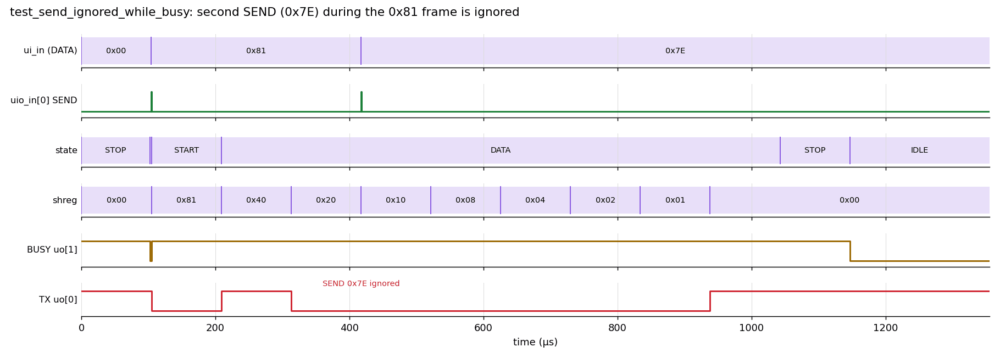
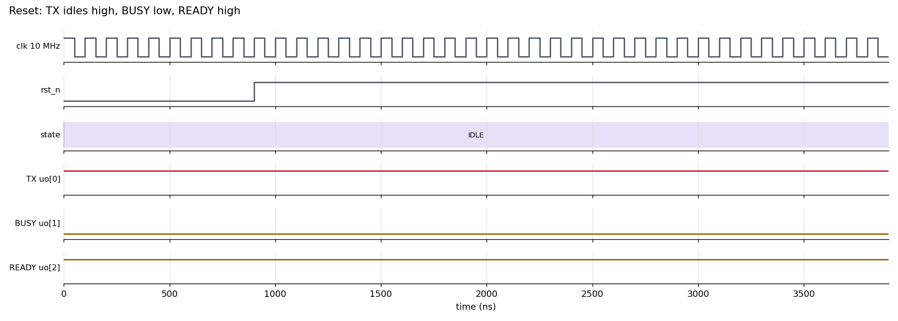
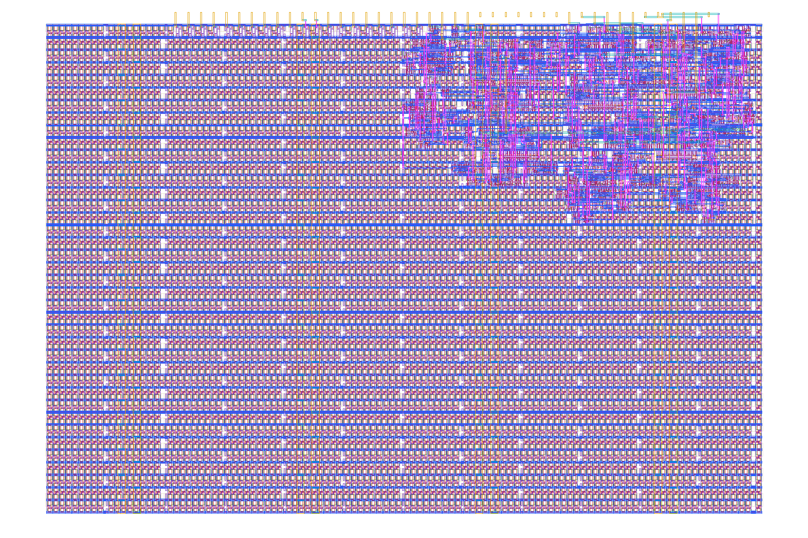
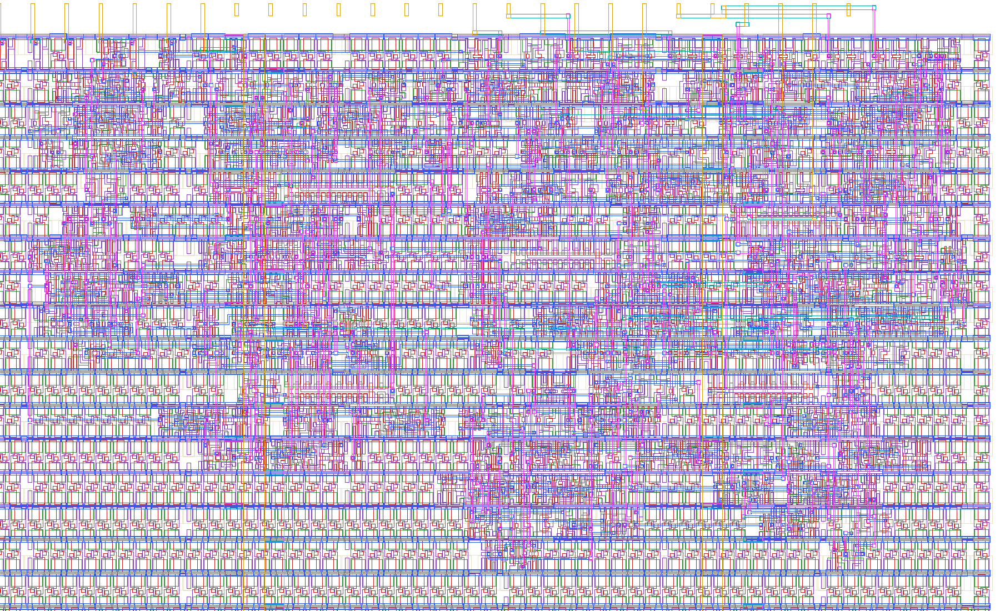
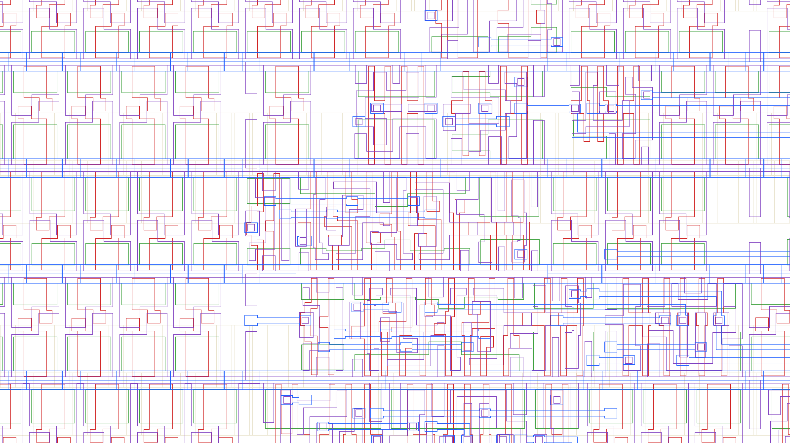

  

# 8-Bit UART Transmitter (8N1, 9600 baud)

A small [Tiny Tapeout](https://tinytapeout.com) ASIC for the SKY130 process (TTSKY26e shuttle). It takes an 8-bit
parallel byte and sends it out as a standard UART serial frame, so any USB-to-UART adapter or Arduino can receive it.

- **Frame:** 8N1 (1 start bit, 8 data bits LSB first, no parity, 1 stop bit)
- **Clock:** 10 MHz
- **Baud rate:** 9600 (10 MHz / 1042, 0.03% error)
- **Size:** 1x1 tile
- **Layout viewer:** https://ayush-hegde.github.io/Tapeout/
- **Datasheet:** [docs/info.md](docs/info.md)

## How it works

| Block | Description |
|---|---|
| Baud counter | 11-bit counter producing a tick every 1042 clocks (one bit period) |
| Control FSM | 4 states: IDLE, START, DATA, STOP |
| Shift register | 8-bit register loaded from `ui_in`, shifted out one bit per baud tick |
| Bit counter | 3-bit counter for the 8 data bits |
| SEND synchronizer | 2-flop synchronizer plus rising-edge detect on the asynchronous SEND pin |

A rising edge on SEND loads the byte and starts a frame. A SEND that arrives during a frame is ignored. Each frame
takes 10 bit periods, about 1.04 ms. The source is in [src/project.v](src/project.v).

## Pinout

| Pin | Direction | Function |
|---|---|---|
| `ui[7:0]` | in | DATA, the byte to send |
| `uio[0]` | in | SEND, a rising edge starts a frame |
| `uo[0]` | out | TX serial line (idles high) |
| `uo[1]` | out | BUSY, high while a frame is being sent |
| `uo[2]` | out | READY, the inverse of BUSY |

All other pins are unused.

## Testing

### Simulation

The cocotb testbench in [test/](test) contains a software UART receiver. It checks the idle level, several bytes
(0x55, 0xA5, 0x00, 0xFF, 0x3C, "Hi"), the frame length, and that SEND is ignored while busy.

```sh
cd test
make -B              # Linux / macOS
python run_local.py  # Windows, no make needed
```

The GitHub Actions workflows run the same tests on the RTL and on the gate-level netlist after hardening.

### Simulation waveforms

One complete frame for 0x55: start bit, D0 to D7 (LSB first), stop bit. Each bit lasts 1042 clocks (104.2 µs).



SEND passes through a 2-flop synchronizer and edge detector. The byte is captured and the start bit begins on the
third clock edge after SEND rises.



The baud counter counts 0 to 1041; its tick advances the FSM to the next bit.



All seven test bytes sent back to back, each decoded correctly by the testbench receiver.



A second SEND (0x7E) in the middle of the 0x81 frame is ignored, so the frame is not corrupted.



After reset, TX idles high, BUSY is low and READY is high.



### On the chip

1. On the Tiny Tapeout demo board, select this project and set the clock to 10 MHz.
2. Connect `uo[0]` (TX) and GND to the RX pin of a 3.3 V USB-UART adapter, or to the RX pin of an Arduino.
3. Open a serial terminal at 9600 baud, 8N1.
4. Set `ui[7:0]` to a character (for example `0x41` for `A`), then pulse `uio[0]` high and low.
5. The character appears in the terminal.

Things to watch on real hardware:

- **Clock accuracy.** The baud rate is the clock divided by 1042, and UART tolerates only about 2% error. If the
  board reports a clock that is not exactly 10.00 MHz (a 125 MHz RP2040 clock can only make 9.62 or 10.42 MHz), set
  the RP2040 system clock to a multiple of 10 MHz first, for example `machine.freq(120_000_000)`.
- **Data hold.** The byte is captured 2 to 3 clocks after SEND rises. Set `ui[7:0]` before SEND and keep it unchanged
  until BUSY (`uo[1]`) goes high.
- **Voltage.** The chip only drives TX, so a 5 V Arduino can read it directly. Never drive the chip's pins from 5 V.

See the [datasheet](docs/info.md) for details.

## Layout

The final SKY130 layout of the 1x1 tile (161 x 111.5 µm). The placed and routed logic sits in the top-right; the rest
of the tile is filled with decoupling capacitor and filler cells. An interactive 3D view is at
https://ayush-hegde.github.io/Tapeout/.



Zoom on the placed and routed logic, and a close-up around one of the 28 flip-flops:





Layer colours: green = diffusion, red = poly, purple = li1, blue = metal 1, pink = metal 2, teal = metal 3,
orange = metal 4.

| Item | Value |
|---|---|
| Tile | 1x1, 161 x 111.5 µm |
| Flip-flops | 28 (`sky130_fd_sc_hd__dfxtp_2`) |
| Logic cells | 194, including clock tree, hold buffers and tie cells |
| Transistors | 2,356 in active cells (1,834 in core logic) |

## Open-source flow

| Step | Tool |
|---|---|
| Simulation | Icarus Verilog + cocotb |
| Synthesis | Yosys + ABC |
| Floorplan, place, CTS, route | OpenROAD (via LibreLane) |
| Static timing | OpenSTA |
| DRC / LVS | Magic / Netgen |
| PDK | SkyWater SKY130 |

## Author

Ayush Hegde, [@Ayush-Hegde](https://github.com/Ayush-Hegde)

Licensed under [Apache 2.0](LICENSE).
